# Furniture Retrieval System

Shop-the-look visual search. Upload a room photo; the system detects furniture and decor, crops each object, embeds it with CLIP and returns the most similar products from a Qdrant catalog. A room takes about 0.6 s end to end on a laptop CPU.

Built with **HUBX**, Nov 2025 – Feb 2026, and run as a demo service on an AWS EC2 GPU instance.

## Highlights

- **Distilled an open-vocabulary detector into a fast closed-set one.** YOLO-World with 114 prompts labelled the data; a YOLO11m student trained on those labels (5 classes) replaces it in the pipeline.
- **1.5× faster end to end than the YOLO-World pipeline** (642 vs 960 ms per room on CPU), with **31% fewer CLIP calls** and 94% of its room recall.
- **Better retrieval per crop.** At an equal crop budget of 5–10 crops per room, recall@5 is **+7–8 points** higher than YOLO-World (significant, paired bootstrap).
- **A data engine at scale.**
  - 1.85M images collected and deduplicated to 1.71M.
  - A 40k diverse "golden set" selected with K-Means + Farthest Point Sampling on CLIP embeddings.
  - The full 1.85M pool pseudo-labelled in 11.5 h.
  - 4 active-learning phases, taking mAP50 from 0.695 to 0.735.
- **Ready to run.** One `docker compose up` starts the REST API, the web UI and the vector DB on CPU, with the trained model included. The benchmarks are reproducible scripts.

## Pipeline

```mermaid
flowchart LR
  A[public interior-design sites<br/>1.91M links] -->|parallel download| B[1.85M images<br/>42 room categories]
  B -->|CLIP ViT-B/32| C[image embeddings]
  C -->|FAISS dedup 0.98<br/>K-Means 28k + FPS 12k| D[golden set<br/>40k images]
  D -->|YOLO-World<br/>114 prompts to 5 classes| E[pseudo-labelled<br/>detection dataset]
  E -->|YOLO11m fine-tune<br/>4 active-learning phases| F[Golden.pt]
  F --> G[service: detect, post-process, crop<br/>CLIP embed, Qdrant top-K]
```



The 5 classes are Furniture, Textile, Lighting, Decoration and Appliance.

1. **Data collection.** 1,912,541 image links were collected from public interior-design websites across 42 room categories, and 1,850,924 images were downloaded in parallel.
2. **Golden set selection.** Every image was embedded with CLIP ViT-B/32.
   - FAISS near-duplicate removal (cosine 0.98) reduced the pool to 1,713,762 images.
   - K-Means picked 28,000 representative images and Farthest Point Sampling picked 12,000 outliers, giving a diverse 40,000-image training set.
3. **Annotation.** SAM3 masks were accurate but too slow for 114 prompts, so the pipeline switched to YOLO-World boxes and mapped the 114 open-vocabulary prompts to 5 classes. Retrieval only needs a crop, so boxes are enough.
4. **Training.** YOLO11m was trained on the golden set, then refined through 4 active-learning phases: mined hard examples, consolidation, a Lighting-focused phase and a rebalancing phase.
5. **Service.** FastAPI + Qdrant + Streamlit.
   - Post-processing merges fragmented same-class boxes and drops ambiguous cross-class duplicates.
   - Each crop is embedded with CLIP and searched in Qdrant, filtered by the detected class and grouped by product.

Details: [docs/](docs/).

## Results

### Retrieval benchmark (250 synthetic rooms, 190-product catalog)

The full pipeline is run with each detector; everything else (CLIP, search, thresholds) is identical. CPU, Apple M5. Method and scripts: [benchmarks/](benchmarks/).

| Pipeline | Recall@5 | Crops / room | Total latency (mean) | Rooms / s |
|---|---|---|---|---|
| **Golden.pt (YOLO11m) + post-processing** | 0.685 | **16.6** | **642 ms** | **1.56** |
| YOLO-World v8l, 114 prompts | 0.729 | 24.2 | 960 ms | 1.04 |

Equal crop budget (each detector keeps its N most confident crops), recall@5:

| Crops / room | 5 | 8 | 10 |
|---|---|---|---|
| **Golden.pt** | **0.441** | **0.565** | **0.608** |
| YOLO-World | 0.358 | 0.490 | 0.539 |

### Data and training

| Metric | Value | Source |
|---|---|---|
| Images collected / after deduplication | 1,850,924 / 1,713,762 | [`golden_dataset_creator.ipynb`](notebooks/executed/golden_dataset_creator.ipynb) |
| Golden set | 40,000 (28k K-Means + 12k FPS) | same notebook |
| Pseudo-labelling of the full 1.85M pool | 11 h 28 min, 44.8 images/s | [`yolo_world_full_pool_annotation.ipynb`](annotation/yolo_world_full_pool_annotation.ipynb) |
| Base YOLO11m (golden set) | mAP50 0.695, mAP50-95 0.613 | [`runs/yolov11m_superclass`](training/runs/yolov11m_superclass/results.csv) |
| **Final model `Golden.pt`** | **mAP50 0.735, mAP50-95 0.649, P 0.806, R 0.637** | [`runs/phase3_5_rebalance2`](training/runs/phase3_5_rebalance2/results.csv) |

| Phase | Run | Data | P | R | mAP50 | mAP50-95 |
|---|---|---|---|---|---|---|
| Base | `yolov11m_superclass` | golden set (40k) | 0.768 | 0.603 | 0.695 | 0.613 |
| 1. Hard examples | `stage1_adaptation_hard10k` | 10k mined hard examples | 0.823 | 0.654 | 0.750* | 0.658* |
| 2. Consolidation | `stage2_consolidation_44k` | 44k | 0.794 | 0.629 | 0.723 | 0.633 |
| 3. Lighting | `phase3_lighting_specialization` | Lighting-focused set | 0.624 | 0.530 | 0.585† | 0.500† |
| 3.5 Rebalance | `phase3_5_rebalance` | 44k | 0.775 | 0.594 | 0.693 | 0.589 |
| 3.5 Rebalance (final) | `phase3_5_rebalance2` | 44k | 0.806 | 0.637 | **0.735** | **0.649** |

\* Validated on its own training images (`prepare_hard_examples.py` writes the same set to train and val).
† Measured on the Lighting-focused validation set.

Each run folder in [`training/runs/`](training/runs/) has `args.yaml`, `results.csv`, PR/F1 curves and confusion matrices.

## Quick start

Requires Docker with Compose. Everything runs on CPU, and the trained model ships with the repo.

```bash
git clone https://github.com/subhanakbenli/furniture-retrieval-system.git
cd furniture-retrieval-system/service
docker compose up -d --build    # first build takes a few minutes
```

| Service | URL |
|---|---|
| Web UI (Streamlit) | http://localhost:8501 |
| API + Swagger | http://localhost:8000/docs |

Upload a room photo in the **Visualize** tab, or call the API:

```bash
curl -F "file=@room.jpg" http://localhost:8000/detect          # boxes as JSON
curl -F "file=@room.jpg" http://localhost:8000/visualize -o out.jpg
```

Batch detection over a folder:

```bash
pip install requests pillow
python scripts/predict_folder.py path/to/images --out results/ --save-images
```

For retrieval, add products in **Add to Database**, then search with a room photo in **Search Objects**. API reference: [service/docs/api.md](service/docs/api.md).

## Repository layout

```
data_pipeline/dataset_creation/  CLIP embedders, embedding merger, FAISS + K-Means + FPS golden set selector
annotation/                      SAM3 and YOLO-World annotation notebooks
training/                        training, hard-example mining, evaluation scripts
  runs/                          args.yaml, results.csv and plots of every training phase
service/                         FastAPI + Qdrant + Streamlit service, Dockerfile, final weights
benchmarks/                      end-to-end and detector comparison benchmarks
notebooks/executed/              notebooks with their run outputs
docs/                            timeline, data pipeline, training and evaluation, retrieval service
```

Datasets (~130 GB) and intermediate checkpoints are not included; the final model is `service/weights/Golden.pt` (40 MB).

## Next steps

- **Edge deployment.** Export to ONNX / CoreML / TFLite with int8 quantization, and train a YOLO11n/s student on the same pseudo-labels.
- **Lighter embedding.** Replace CLIP ViT-B/32 with MobileCLIP; crop embedding is now the most expensive stage.
- **Human-verified labels and real photos.** The current labels are YOLO-World pseudo-labels, and the benchmark rooms are synthetic.
- **Lighting.** The weakest class (AP50 0.617) and the main target for more data.
- **Security.** Add authentication before exposing the API or UI beyond a trusted network.

## Contributors

Sübhan Akbenli · Berkay Fehmi Tekin · Mert Güden

## License

[MIT](LICENSE). Covers code and documentation, not third-party images.
