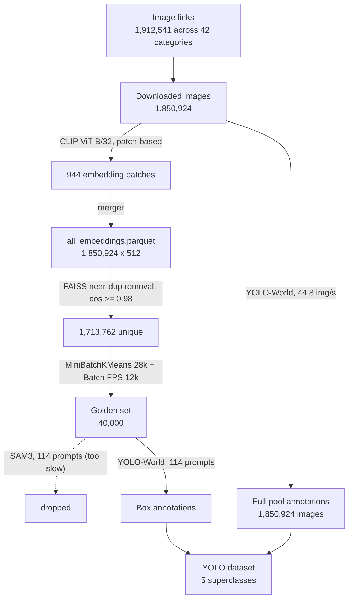

# Data Pipeline

How 1.85 million interior photos became a 40,000-image golden set and a 5-class YOLO detection dataset.

## Overview



| Step | Count |
|---|---:|
| Room categories | 42 |
| Image links collected | 1,912,541 |
| Images downloaded and embedded | 1,850,924 |
| After near-duplicate removal | 1,713,762 |
| Golden set | 40,000 (28,000 K-Means + 12,000 FPS) |
| Full pool annotated with YOLO-World | 1,850,924 |

## 1. Data collection

1,912,541 image links were collected from public interior-design websites across 42 room categories (living room, bedroom, kitchen, bathroom, home office, patio and others). 1,850,924 images were downloaded, with the download split across three machines, and stored as one folder per category.

## 2. CLIP embedding

Every image gets a 512-d, L2-normalised CLIP vector. These vectors drive deduplication and diversity-based selection of the golden set.

- Model: `open_clip` ViT-B-32, `pretrained='laion2b_s34b_b79k'`.
- Runtime: Google Colab GPU, images extracted from per-machine archives onto the local disk.

Two notebook versions exist:

| Notebook | Approach | Role |
|---|---|---|
| [`clip_embedder_folder_based.ipynb`](../data_pipeline/dataset_creation/clip_embedder_folder_based.ipynb) | One output per category folder, capped at 5,000 images per folder | First version |
| [`clip_embedder_patch_based.ipynb`](../data_pipeline/dataset_creation/clip_embedder_patch_based.ipynb) | Splits each folder into patches of 2,000 images, no cap | Final run |

The patch-based version was written to cover the whole pool and survive Colab disconnects:

- `PATCH_SIZE=2000`, `BATCH_SIZE=128`.
- Folders are visited round-robin, one patch at a time.
- Each finished patch is written immediately as `<category>_patch_<N>.csv` (image paths) plus `<category>_patch_<N>.npy` (float32, N x 512).
- A `checkpoint.json` records progress, so an interrupted session resumes where it stopped.

The final run produced **944 patches** (1 to 39 per category, 3.79 GB of NPY).

A command-line variant for long-running GPU instances, [`standalone_clip_embedder.py`](../data_pipeline/dataset_creation/standalone_clip_embedder.py), has the same model and adds graceful shutdown on interruption.

### Merging

[`colab_embed_merger.ipynb`](../data_pipeline/dataset_creation/colab_embed_merger.ipynb) reads all patch files and writes a single `all_embeddings.parquet` with columns `folder_name, image_name, embedding (list[512])`, plus a `summary.json`. Result: 944/944 patches, **1,850,924 rows, 5.89 GB**.

## 3. Golden set selection

Annotating and training on 1.85M images is expensive, and much of the pool is redundant (similar rooms, repeated listings). The goal was a 40,000-image subset that is duplicate-free, covers the common visual modes, and still includes unusual scenes.

Notebook: [`faiss_kmeans_dataset_selector.ipynb`](../data_pipeline/dataset_creation/faiss_kmeans_dataset_selector.ipynb) (executed run with outputs: [`golden_dataset_creator.ipynb`](../notebooks/executed/golden_dataset_creator.ipynb)). Ran on an A100 with `faiss-gpu`.

### 3.1 Near-duplicate removal

- Exact cosine search with FAISS `GpuIndexFlatIP`, K=10 neighbours per vector, in batches of 10k.
- Pairs with similarity >= 0.98 are merged into groups with Union-Find; the first image of each group is kept.
- Result: 1,850,924 -> **1,713,762** (7.4% removed). This also removes images that appeared in more than one category.

### 3.2 K-Means: representative samples (28,000)

- `MiniBatchKMeans(n_clusters=28000, batch_size=4096, n_init=3, max_iter=100, random_state=42)`.
- The image nearest to each centroid is selected.
- Why: centroid-nearest samples act as prototypes of dense regions, so the subset mirrors the main distribution of rooms and styles. This follows the prototype-based data pruning idea in Sorscher et al., *Beyond neural scaling laws* ([arXiv:2206.14486](https://arxiv.org/abs/2206.14486)).

### 3.3 Farthest Point Sampling: edge cases (12,000)

- Seeded with the K-Means selections. Distance = `1 - max cosine` to the already selected set.
- Batch variant: each of 120 iterations adds the 100 farthest points.
- Why: K-Means alone under-samples rare scenes. FPS greedily adds the images farthest from everything already chosen, which fills gaps in the embedding space. It is the k-Center Greedy strategy from Sener and Savarese, *Active Learning for Convolutional Neural Networks: A Core-Set Approach* ([arXiv:1708.00489](https://arxiv.org/abs/1708.00489)). The batch variant is faster than classic FPS at the cost of some redundancy within a batch.

### 3.4 Result

`golden_dataset.parquet` with 40,000 rows (`folder_name, image_name, embedding, selection_method`). All 42 categories are represented; the largest are living_room (2,163), baby_kids (2,057), family_room (1,953) and bedroom (1,891). K-Means picked 183 images twice (nearest to two centroids), so the set holds about 39.8k unique images.

## 4. Annotation

The detector needs boxes for a broad furniture and decor vocabulary. Labels were produced automatically with open-vocabulary models prompted with 114 text prompts.

### 4.1 SAM3 (first attempt)

SAM3 produces high-quality masks from text prompts. An early 8-class run on 3,605 living-room images took **~2.3 s/image on an A100** ([`sam_annotation_living_room.ipynb`](../notebooks/executed/sam_annotation_living_room.ipynb)). The 114-prompt version for the golden set ([`Golden_Annotation.ipynb`](../notebooks/executed/Golden_Annotation.ipynb)) encodes each image once and queries each prompt separately, but the per-prompt cost scales with the vocabulary, which made 40k images impractical.

### 4.2 YOLO-World (final)

The pipeline switched to box-only annotation with YOLO-World (`yolov8l-worldv2.pt`), using the same 114 prompts as an offline vocabulary.

- `conf=0.15`, NMS `iou=0.5`, `model.fuse()`.
- Golden set: [`yoloworld_model_interface.py`](../data_pipeline/dataset_creation/yoloworld_model_interface.py) (`FurnitureAnnotatorYOLO`), a producer -> GPU -> writer thread pipeline that writes one COCO-style JSON per image.
- Full pool: [`yolo_world_full_pool_annotation.ipynb`](../annotation/yolo_world_full_pool_annotation.ipynb) streams results into a single `all_coco.json` (images and annotations written as JSONL first, then combined to keep memory flat).
- Throughput: **1,850,924 images in 11 h 28 min, 44.8 images/s**. At this speed the golden set takes about 15 minutes.

### 4.3 Class hierarchy: 114 prompts -> 5 superclasses

Fine-grained prompts give the open-vocabulary model better recall; the detector is trained on 5 superclasses. Each prompt carries a `supercategory`, and labels are mapped to it when building the YOLO dataset.

| Superclass (id) | Prompts | Examples |
|---|---:|---|
| Furniture (0) | 33 | sofa, couch, armchair, chair, stool, bench, ottoman, dining table, coffee table, nightstand, desk, wardrobe, cabinet, dresser, bookshelf, TV stand, bed frame, headboard, shoe rack |
| Textile (1) | 22 | rug, carpet, runner, curtain, drape, window blind, pillow, cushion, blanket, duvet, quilt, comforter, bedding, towel, bath mat |
| Lighting (2) | 12 | floor lamp, table lamp, desk lamp, bedside lamp, ceiling light, pendant light, chandelier, wall sconce, wall lamp, lampshade |
| Decoration (3) | 26 | vase, planter, potted plant, mirror, picture frame, painting, wall art, sculpture, candle, candle holder, decorative bowl, tray, basket, wall clock |
| Appliance (4) | 21 | television, monitor, refrigerator, washing machine, dishwasher, oven, stove, microwave, coffee maker, speaker, air conditioner, fan, radiator |
| **Total** | **114** | |

The full list is in `_generate_categories()` in [`yoloworld_model_interface.py`](../data_pipeline/dataset_creation/yoloworld_model_interface.py). Synonyms (sofa/couch, rug/carpet, refrigerator/fridge) are intentional: they raise recall, and since both map to the same superclass they only produce a duplicate box that per-class NMS removes.

### 4.4 YOLO dataset format

```
furniture_yolo_final/
├── train/images/*.jpg   train/labels/*.txt
├── val/images/*.jpg     val/labels/*.txt
└── data.yaml            # nc: 5, names: {0: Furniture, 1: Textile, 2: Lighting, 3: Decoration, 4: Appliance}
```

Each COCO box `[x, y, w, h]` in pixels is converted to a normalised `class_id x_center y_center width height` line, with `class_id` taken from the prompt's superclass. Training uses `imgsz: 640` (see [`02-training-and-evaluation.md`](02-training-and-evaluation.md)).

## Notebooks and scripts

| Step | File | Executed run |
|---|---|---|
| CLIP embedding (first version) | [`clip_embedder_folder_based.ipynb`](../data_pipeline/dataset_creation/clip_embedder_folder_based.ipynb) | [`colab_embedder.ipynb`](../notebooks/executed/colab_embedder.ipynb) |
| CLIP embedding (final) | [`clip_embedder_patch_based.ipynb`](../data_pipeline/dataset_creation/clip_embedder_patch_based.ipynb) | |
| CLIP embedding (CLI) | [`standalone_clip_embedder.py`](../data_pipeline/dataset_creation/standalone_clip_embedder.py) | |
| Patch merger | [`colab_embed_merger.ipynb`](../data_pipeline/dataset_creation/colab_embed_merger.ipynb) | [`colab_embed_merger.ipynb`](../notebooks/executed/colab_embed_merger.ipynb) |
| Golden set selection | [`faiss_kmeans_dataset_selector.ipynb`](../data_pipeline/dataset_creation/faiss_kmeans_dataset_selector.ipynb) | [`golden_dataset_creator.ipynb`](../notebooks/executed/golden_dataset_creator.ipynb) |
| SAM3, 8 classes | [`sam3_bedroom_coco_annotator.ipynb`](../annotation/sam3_bedroom_coco_annotator.ipynb) | [`sam_annotation_living_room.ipynb`](../notebooks/executed/sam_annotation_living_room.ipynb) |
| SAM3, 114 prompts | | [`Golden_Annotation.ipynb`](../notebooks/executed/Golden_Annotation.ipynb) |
| YOLO-World, golden set | [`yoloworld_model_interface.py`](../data_pipeline/dataset_creation/yoloworld_model_interface.py) | |
| YOLO-World, full pool | [`yolo_world_annotations.ipynb`](../data_pipeline/dataset_creation/yolo_world_annotations.ipynb) | [`yolo_world_full_pool_annotation.ipynb`](../annotation/yolo_world_full_pool_annotation.ipynb) |
| CLIP-based filtering (experiment) | [`quality_filter_with_clip.ipynb`](../annotation/quality_filter_with_clip.ipynb) | [`clip_filtering_images.ipynb`](../notebooks/executed/clip_filtering_images.ipynb) |

Python dependencies for the dataset notebooks: [`requirements.txt`](../data_pipeline/dataset_creation/requirements.txt). Notebooks under `annotation/` and `data_pipeline/dataset_creation/` read paths from a `DRIVE_ROOT` constant at the top; set it before running. SAM3 requires a Hugging Face token, read from Colab secrets (`HF_TOKEN`).

## Limitations

- Labels are YOLO-World pseudo-labels, not human annotations. Detector metrics therefore measure agreement with these labels.
- The 0.98 Union-Find grouping is transitive, so long chains can merge images that are less similar than the threshold.
- Embeddings are normalised at extraction time, so the raw CLIP norm is not available as a quality signal.
- Outdoor categories (backyard, pool, patio, landscape) make up a large share of the golden set and contribute few indoor objects.
- Images and annotation files are not distributed with this repo.
