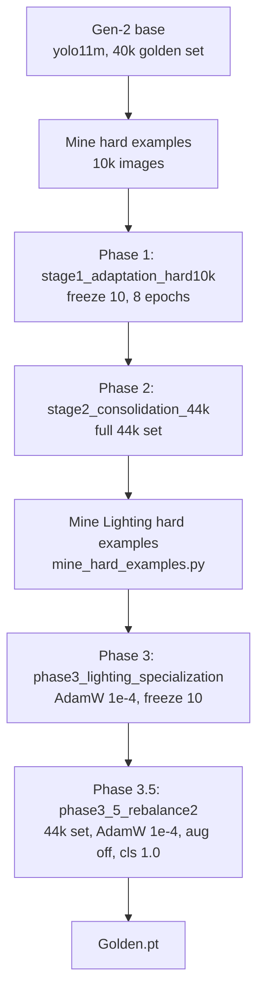

# 02 — Training and Evaluation

How the YOLO11m detector was trained on YOLO-World pseudo-labels, refined in four active-learning phases, and evaluated.

All metrics below come from the `args.yaml` and `results.csv` files and validation plots in [`../training/runs/`](../training/runs/). Training used Ultralytics at `imgsz=640`, `batch=16`.

## Model generations

| Generation | Model | Data | Classes | Result |
|---|---|---|---|---|
| Prototype | YOLO11 segmentation + Gradio UI | ~10k SAM3-labeled images | 8 fine-grained | Proof of concept; replaced by the detection pipeline |
| Gen-2 | YOLO11m (`yolo11m.pt`, COCO-pretrained) | 40k golden set, YOLO-World pseudo-labels | 5 superclasses | mAP50 0.695, mAP50-95 0.613 |
| Final (`Golden.pt`) | Gen-2 + 4 active-learning phases | Mined hard examples, 44k consolidated set | 5 superclasses | mAP50 0.735, mAP50-95 0.649 |

Classes: `0 Furniture, 1 Textile, 2 Lighting, 3 Decoration, 4 Appliance`. They are the superclasses of the 114 YOLO-World prompts. Labeling and golden-set selection are covered in [`01-data-pipeline.md`](01-data-pipeline.md).

## Run table

Each run starts from the previous run's `best.pt`. "Best epoch" is the epoch Ultralytics keeps as `best.pt` (fitness = 0.1 · mAP50 + 0.9 · mAP50-95). Metrics are for that epoch.

| Run | Data | Epochs (run / set) | Optimizer · lr | Freeze | Best epoch | P | R | mAP50 | mAP50-95 | Time |
|---|---|---|---|---|---|---|---|---|---|---|
| [`yolov11m_superclass`](../training/runs/yolov11m_superclass/) | golden set (`furniture_yolo_final`) | 50 / 50 | auto (SGD 0.01) | – | 50 | 0.768 | 0.603 | 0.695 | 0.613 | 7.9 h |
| [`stage1_adaptation_hard10k`](../training/runs/stage1_adaptation_hard10k/) | 10k hard examples | 8 / 8 | auto (AdamW ~1.1e-3) | 10 | 8 | 0.823 | 0.654 | 0.750* | 0.658* | 0.5 h |
| [`stage2_consolidation_44k`](../training/runs/stage2_consolidation_44k/) | 44k set | 11 / 40 | auto (SGD 0.01) | 0 | 1 | 0.794 | 0.629 | 0.723 | 0.633 | 2.3 h |
| [`phase3_lighting_specialization`](../training/runs/phase3_lighting_specialization/) | Lighting-focused set | 8 / 8 | AdamW 1e-4 | 10 | 8 | 0.624 | 0.530 | 0.585** | 0.500** | 0.15 h |
| [`phase3_5_rebalance`](../training/runs/phase3_5_rebalance/) | 44k set | 4 / 4 | auto (AdamW ~1.1e-3) | – | 4 | 0.775 | 0.594 | 0.693 | 0.589 | 0.8 h |
| [`phase3_5_rebalance2`](../training/runs/phase3_5_rebalance2/) | 44k set | 8 / 8 | AdamW 1e-4 | – | 5 | **0.806** | **0.637** | **0.735** | **0.649** | 1.7 h |

\* Measured on the training images (see [Limitations](#limitations)).
\** Measured on the Lighting-focused validation set; not comparable with the other rows.

The runs on the 44k set (`stage2`, both `phase3_5` runs) share a validation set and compare directly. `phase3_5_rebalance2/weights/best.pt` is the production `Golden.pt` that [`../service/src/ml_engine.py`](../service/src/ml_engine.py) loads.

Augmentation settings by phase:

- Gen-2, Phase 1, Phase 2: Ultralytics defaults (mosaic 1.0, fliplr 0.5, scale 0.5, HSV jitter), `cache=True`.
- Phase 3: mosaic off, HSV saturation/value 0.3, backbone frozen (`freeze=10`).
- Phase 3.5: all geometric and color augmentation off, classification loss weight `cls` raised from 0.5 to 1.0, `warmup_epochs=0.5`.

## Active-learning loop



**Step 0 — Base model.** `yolo11m.pt` trained for 50 epochs on the golden set. mAP50 was still rising at epoch 50.

**Step 1 — Mine hard examples.** The current model is run over the unlabeled image pool and images where it is uncertain are sampled. [`mine_hard_examples.py`](../training/mine_hard_examples.py) (`mine_hard_examples_stochastic`) implements the strategy used for the Lighting round:

1. Draw a random image from the pool (no repeats, at most `target_count × 20` attempts).
2. Predict with `conf=0.15`, `iou=0.5`. Images with no detections are skipped.
3. Assign the image to the first category whose quota is not yet full:

   | Category | Quota | Condition |
   |---|---|---|
   | weak | 60% | A Lighting box exists and the highest Lighting confidence is in 0.15–0.55 |
   | context | 20% | Lighting and Furniture appear in the same image |
   | negative | 20% | Furniture present, no Lighting (hard negative for Lighting) |

4. Stop at `target_count` (default 6,000) and write `path, category, detections, max_confidence` to a CSV.

Weak detections give the model borderline positives. Context and negative images teach it to tell lamps apart from the furniture around them. The quotas keep the set from being made up only of low-confidence crops.

**Step 2 — Build the dataset.** [`prepare_hard_examples.py`](../training/prepare_hard_examples.py) looks up each CSV entry in the labeled 44k set (train first, then val), copies image and label into a new folder and writes a `data.yaml`.

**Step 3 — Phase 1, adaptation.** Gen-2 is fine-tuned on the 10k hard examples for 8 epochs with the first 10 layers frozen, so the head adapts while the backbone stays fixed.

**Step 4 — Phase 2, consolidation.** Full fine-tuning on the 44k set. `optimizer=auto` picked SGD at lr 0.01 for the 40-epoch schedule and overrode the requested `lr0=0.001`. mAP50 dropped from 0.723 (epoch 1) to 0.680 (epoch 4) and early stopping ended the run at epoch 11, so `best.pt` is epoch 1.

**Step 5 — Phase 3, Lighting specialization.** Lighting was the weakest class, so a Lighting-focused set was mined (Step 1) and trained with AdamW at 1e-4, the backbone frozen and mosaic off.

**Step 6 — Phase 3.5, rebalancing.** Specializing on Lighting hurt the other classes, so the Phase 3 weights were retrained on the full 44k set at low lr with augmentation off and a higher classification loss weight. The first attempt (`optimizer=auto`) again overrode `lr0` and used AdamW ~1.1e-3: mAP50 fell to 0.602 after one epoch and reached 0.693 after four. The second attempt set `optimizer=AdamW` explicitly so lr 1e-4 applied. It started at 0.730, peaked at 0.737 mAP50 at epoch 3, and its best fitness was at epoch 5 (0.735 / 0.649). That checkpoint is `Golden.pt`.

## Per-class results of the final model

From the PR curves and normalized confusion matrices of the final run and the Gen-2 run.

| Class | AP50 Gen-2 | AP50 Golden | Recall (confusion matrix) Golden | Missed as background Golden |
|---|---|---|---|---|
| Furniture | 0.758 | 0.777 | 0.69 | 0.29 |
| Textile | 0.694 | 0.759 | 0.70 | 0.29 |
| Lighting | 0.597 | 0.617 | 0.53 | **0.46** |
| Decoration | 0.712 | 0.743 | 0.68 | 0.29 |
| Appliance | 0.716 | 0.781 | 0.67 | 0.23 |
| **All** | **0.695** | **0.735** | | |

Confusion between classes is low (at most 0.04 off-diagonal). Most errors are object vs. background: missed objects (bottom row) and false positives on background, highest for Decoration (0.34), Furniture (0.29) and Textile (0.25). Lighting gained +0.02 AP50 but stays the weakest class, with 46% of lighting objects predicted as background.

## Post-processing

Detections pass through two rules before cropping and embedding:

1. **Cross-class overlap:** two boxes of different classes with IoU > 0.97 are both dropped.
2. **Same-class merge:** when a smaller same-class box lies inside a larger one with IoF > `iof_threshold` (default 0.5), it is merged into their union.

The service version is [`../service/src/postprocess.py`](../service/src/postprocess.py). [`../training/inference_with_postprocessing.py`](../training/inference_with_postprocessing.py) is an earlier version that keeps the higher-scoring box instead of merging (IoF 0.85). Details are in [`03-retrieval-and-service.md`](03-retrieval-and-service.md).

## Retrieval benchmark

The full pipeline (detect, crop, CLIP embed, catalog search) is evaluated on 250 synthetic rooms built from a 190-product catalog, with the source products of each room known. Room recall is the share of a room's products found in the top-5 results of any crop, averaged over rooms. Golden.pt is compared with the YOLO-World teacher (v8l, the same 114 prompts mapped to 5 classes); everything except the detector is shared. Results are from CPU (Apple M5).

| Pipeline | Recall@5 | Recall@1 | Crops / room | Total latency | Rooms / s |
|---|---|---|---|---|---|
| **Golden.pt + post-processing** | 0.685 | 0.431 | **16.6** | **642 ms** | **1.56** |
| YOLO-World v8l | 0.729 | 0.476 | 24.2 | 960 ms | 1.04 |
| YOLO-World v8l + agnostic NMS | 0.718 | 0.466 | 19.0 | 854 ms | 1.17 |

The student reaches 94% of the teacher's room recall at 1.5× the end-to-end speed. It also emits 31% fewer crops, so it makes 31% fewer CLIP calls, and embedding is the most expensive stage.

Recall at the room level rises with the number of crops. With an equal budget of N most-confident crops per room, Golden.pt retrieves more products: recall@5 is 0.441 vs 0.358 at 5 crops and 0.608 vs 0.539 at 10 crops. The difference is significant in a paired bootstrap. Full tables and scripts are in [`../benchmarks/`](../benchmarks/).

## Limitations

- **Pseudo-labels.** Training and validation labels come from YOLO-World and were not reviewed by hand. mAP measures agreement with those labels, not with human ground truth.
- **Phase 1 validation.** `prepare_hard_examples.py` writes the same images to `train` and `val`, so the Phase 1 mAP50 of 0.750 is inflated. The script also pulls hard examples from the 44k validation split, so later scores on that split may be slightly optimistic.
- **`optimizer=auto` overrides `lr0`.** In Phase 1, Phase 2 and the first rebalance run, Ultralytics chose its own optimizer and learning rate. Phase 2's high lr is why its best checkpoint is epoch 1. Set the optimizer explicitly when `lr0` matters.
- **Lighting** remains the weakest class (AP50 0.617, recall 0.53).
- **Gen-2 may not have converged** (best epoch = last epoch).
- **Rebalancing without augmentation** overfits slowly: validation classification loss rises after epoch 3, and the best checkpoint is epoch 5 of 8.
- [`evaluate_model.py`](../training/evaluate_model.py) is a label-free smoke test (detection rate, boxes per image, class counts), not a metric. Reported metrics come from Ultralytics `model.val()`.

## Reproduce

Datasets and intermediate checkpoints are not distributed; only the final model ships, as `service/weights/Golden.pt`. To reproduce, build equivalent datasets with the [data pipeline](01-data-pipeline.md) in YOLO format and run the commands below from [`../training/`](../training/) with Ultralytics on a CUDA GPU. The arguments match the `args.yaml` of each run. Optimizers are set explicitly where the original run relied on `auto`.

```bash
# Gen-2 base
yolo detect train model=yolo11m.pt data=furniture_yolo_final/data.yaml \
  epochs=50 imgsz=640 batch=16 patience=10 cache=True name=yolov11m_superclass

# Mine hard examples with the current model, then build a YOLO dataset from the CSV
python mine_hard_examples.py       # set MODEL, IMAGE_POOL, OUTPUT_CSV in __main__
python prepare_hard_examples.py    # set CSV, source dataset and output folder

# Phase 1 — adaptation on hard examples
yolo detect train model=runs/detect/yolov11m_superclass/weights/best.pt \
  data=dataset_stage1_hard/data.yaml epochs=8 patience=5 imgsz=640 batch=16 \
  freeze=10 optimizer=AdamW lr0=0.0002 cache=True name=stage1_adaptation_hard10k

# Phase 2 — consolidation on the 44k set
yolo detect train model=runs/detect/stage1_adaptation_hard10k/weights/best.pt \
  data=dataset_phase2_yolo_world/data.yaml epochs=40 patience=10 imgsz=640 batch=16 \
  freeze=0 optimizer=AdamW lr0=0.001 cache=True name=stage2_consolidation_44k

# Phase 3 — Lighting specialization (dataset from mine_hard_examples.py)
yolo detect train model=runs/detect/stage2_consolidation_44k/weights/best.pt \
  data=dataset_phase3_yolo_world/data.yaml epochs=8 imgsz=640 batch=16 \
  optimizer=AdamW lr0=0.0001 freeze=10 mosaic=0.0 close_mosaic=0 hsv_s=0.3 hsv_v=0.3 \
  name=phase3_lighting_specialization

# Phase 3.5 — rebalancing (produces Golden.pt)
yolo detect train model=runs/detect/phase3_lighting_specialization/weights/best.pt \
  data=dataset_phase2_yolo_world/data.yaml epochs=8 imgsz=640 batch=16 \
  optimizer=AdamW lr0=0.0001 warmup_epochs=0.5 cls=1.0 \
  mosaic=0.0 fliplr=0.0 scale=0.0 translate=0.0 hsv_h=0.0 hsv_s=0.0 hsv_v=0.0 \
  name=phase3_5_rebalance2

# Validate
yolo detect val model=runs/detect/phase3_5_rebalance2/weights/best.pt \
  data=dataset_phase2_yolo_world/data.yaml
```

[`train_model.py`](../training/train_model.py) wraps the same training, validation (`validate_model`) and export (`export_model`) calls in Python. To serve the model, copy the final `best.pt` to `service/weights/Golden.pt`. The post-processing unit tests run from `../service/` with `python verify_postprocess.py`.
