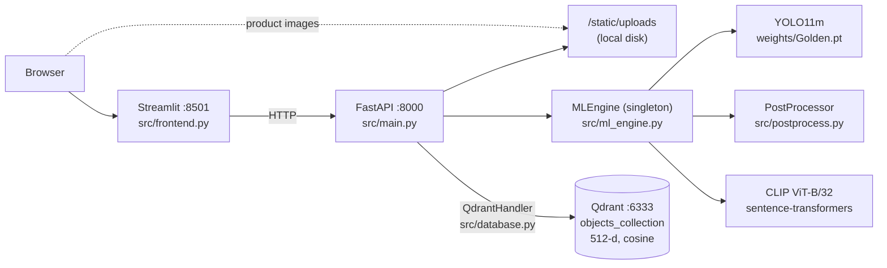
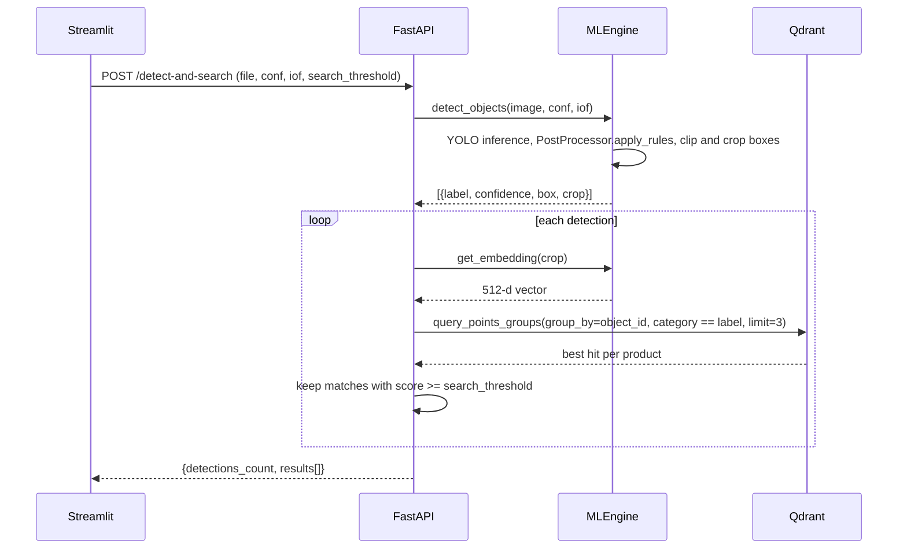

# 03 - Retrieval and Service

The demo service turns a room photo into product matches: YOLO detection, post-processing, bounding-box crops, CLIP ViT-B/32 embeddings and a grouped similarity search in Qdrant, behind a FastAPI backend and a Streamlit UI.

Code: [`../service/`](../service/). Related docs: [00 - Timeline](00-timeline.md) · [02 - Training and evaluation](02-training-and-evaluation.md)

## Architecture



| Component | File | Role |
|---|---|---|
| API | [`src/main.py`](../service/src/main.py) | Endpoints, image I/O, orchestration |
| ML engine | [`src/ml_engine.py`](../service/src/ml_engine.py) | Loads YOLO and CLIP once; detection, cropping, embedding |
| Post-processing | [`src/postprocess.py`](../service/src/postprocess.py) | Cross-class conflict removal and same-class box merging |
| Vector store | [`src/database.py`](../service/src/database.py) | Collection setup, upsert, grouped search, scroll, payload updates |
| UI | [`src/frontend.py`](../service/src/frontend.py) | Search, catalog entry, inventory, post-processing visualizer |
| Deployment | [`Dockerfile`](../service/Dockerfile), [`docker-compose.yml`](../service/docker-compose.yml) | CPU image shared by `api` and `ui`, plus a `qdrant` container; named volumes for vectors and uploads |

The service ran as a demo on an AWS EC2 GPU instance.

## Search request flow



1. The user uploads a scene image in the Search tab and sets detection confidence (default 0.25) and similarity threshold (default 0.60).
2. YOLO runs at the given confidence; the post-processing rules below clean the boxes.
3. Each box is clipped to the image and cropped (bounding box only, no mask). The label is the YOLO class name.
4. Each crop is embedded with CLIP. Qdrant is queried with a `category == label` filter and `group_by="object_id"`, so several images of one product count as a single result; the top 3 products are returned.
5. Matches below `search_threshold` are dropped. The UI draws the boxes and lists the matches per detection.

## Product add flow

1. **Enter metadata.** In the Add to Database tab the user uploads one or more product images and enters name, category (Furniture, Textile, Lighting, Decoration, Appliance), optional price and description.
2. **Analyze.** Each image goes through the detector (via `/detect-and-search`) and the detected boxes are shown as numbered crop cards.
3. **Select.** The user unchecks wrong crops.
4. **Save.** Selected crops are sent as JPEGs with the metadata to `POST /store`. The API assigns an `object_id` (UUID) if none is given, saves each crop to `static/uploads/{point_id}.jpg`, embeds it and upserts one Qdrant point per image.

Catalog images pass through the same detector as queries, so both sides of the search are YOLO crops in the same visual domain. `/store` itself does not run detection; it embeds whatever image it receives. New images for an existing product (variants) reuse its `object_id`.

## API endpoints

Base URL `http://localhost:8000`; Swagger UI at `/docs`. More examples in [`service/docs/api.md`](../service/docs/api.md).

| Method | Path | Request | Response |
|---|---|---|---|
| GET | `/health` | - | `{"status": "ok"}` |
| POST | `/detect` | multipart: `file`; form: `conf_threshold`=0.25, `iof_threshold`=0.5 | `{filename, image: {width, height}, detections: [{label, confidence, box: [x1,y1,x2,y2]}]}` (no catalog search) |
| POST | `/detect-and-search` | multipart: `file`; form: `conf_threshold`=0.25, `iof_threshold`=0.5, `search_threshold`=0.60 | `{detections_count, results: [{label, confidence, box: [x1,y1,x2,y2], matches: [{id, score, metadata, group_id}]}]}` |
| POST | `/store` | multipart: `files` (1..n images), `metadata` (JSON string: `name`, `category`, `price`, `description`, optional `object_id`) | `{status, object_id, point_ids, metadata}`; 400 on invalid JSON |
| POST | `/visualize` | multipart: `file`; form: `conf_threshold`, `iof_threshold` | `image/jpeg` with post-processed boxes drawn |
| GET | `/objects` | query: `limit`=10, `offset` (from previous `next_offset`) | `{results: [{id, metadata}], next_offset}`; one entry per image point |
| PUT | `/objects/{point_id}` | multipart: `metadata` (JSON, should include `object_id`), optional `files` | `{status, id, object_id}`; metadata is applied to every point of the product (`image_url` excluded), files are added as new variants |
| DELETE | `/objects/{point_id}` | path: `point_id` | `{status, deleted_id}`; removes the image file and the Qdrant point |
| GET | `/static/...` | - | Stored product images |

## Qdrant collection schema

| Property | Value |
|---|---|
| Collection | `objects_collection` (created on startup if missing) |
| Vector | 512-d, cosine distance |
| Point | One product image; ID is a UUID that also names the file `static/uploads/{id}.jpg` |
| Payload | `object_id` (product group), `category`, `name`, `description`, `price` (string), `image_url`; extra JSON fields are stored as-is |
| Filter field | `category`, exact match against the YOLO label |
| Grouping | `group_by="object_id"`, best hit per group |
| Payload indexes | None |

## CLIP model

`SentenceTransformer('clip-ViT-B-32')`: the OpenAI CLIP ViT-B/32 image encoder with 512-d output, downloaded from Hugging Face on first start. It is used off the shelf, without fine-tuning; the same embeddings were used to select the golden training set (see [01 - Data pipeline](01-data-pipeline.md)). Vectors are not normalized in code; the cosine metric in Qdrant handles that.

## Post-processing rules

Implemented in [`PostProcessor.apply_rules`](../service/src/postprocess.py) and covered by [`verify_postprocess.py`](../service/verify_postprocess.py). Details in [`service/docs/postprocess.md`](../service/docs/postprocess.md).

| Rule | Condition | Action |
|---|---|---|
| Cross-class conflict | Two boxes of different classes with IoU > 0.97 | Drop both (the class is ambiguous) |
| Same-class merge | Boxes sorted by area, largest first; smaller box's IoF (intersection / smaller box area) > `iof_threshold` (default 0.5) | Replace the larger box with the union of both and drop the smaller one |

The merge rule joins fragmented detections of one object (for example a sofa split into parts). Both thresholds can be explored in the Visualize tab.

## UI tabs

| Tab | Features |
|---|---|
| Search Objects | Upload a scene; sliders for detection confidence and similarity threshold; boxes drawn on the image; per detection, matched products with image, name, score, description and category |
| Add to Database | Two-step detect-and-select flow described above |
| Inventory | Points grouped by `object_id` into product cards; Add Variant, Edit Metadata (dialog, `PUT`), Delete Object, per-variant delete; Load More / First Page pagination (100 points per page) |
| Visualize | Confidence and IoF sliders; shows the `/visualize` output to tune post-processing |

## Configuration

| Setting | Value | Location |
|---|---|---|
| Qdrant | `QDRANT_HOST` / `QDRANT_PORT` (default `localhost:6333`), collection `objects_collection`, size 512 | `database.py` |
| Detector weights | `MODEL_PATH` (default `weights/Golden.pt`) | `ml_engine.py` |
| UI to API | `API_URL` (default `http://localhost:8000`) | `frontend.py` |
| CLIP model | `clip-ViT-B-32` | `ml_engine.py` |
| Upload directory | `static/uploads` (relative) | `main.py` |
| Defaults | conf 0.25, IoF 0.5, similarity 0.60, top 3 products, conflict IoU 0.97 | `main.py`, `postprocess.py` |

The UI fetches stored product images through the API on the server side, so it works when the browser cannot reach the API directly.

## Running

```bash
cd service
docker compose up -d --build     # ui :8501, api :8000, qdrant on localhost:6333
```

The final model ships at `service/weights/Golden.pt`. The image is CPU-only: PyTorch CPU wheels, with the CLIP model downloaded at build time. To run a folder of images through the detector, use [`scripts/predict_folder.py`](../service/scripts/predict_folder.py), which writes `predictions.jsonl`. Running without Docker and the environment variables are covered in the [service README](../service/README.md). Post-processing tests: `python -m unittest verify_postprocess`.

## Limitations

- **Demo security.** No authentication or rate limiting on the API or UI; expose ports 8000 and 8501 only on a trusted network. Qdrant is bound to localhost.
- **Storage.** Images live on local disk (`static/uploads`) and vectors in the Qdrant volume; nothing keeps the two in sync or backs them up.
- **Throughput.** Model and Qdrant calls are synchronous inside `async` endpoints and crops are embedded one at a time, so the service is not built for concurrent load.
- **Evaluation.** End-to-end benchmarks (latency per stage, room recall) are in [`../benchmarks/`](../benchmarks/); the synthetic-room dataset itself is not distributed.
