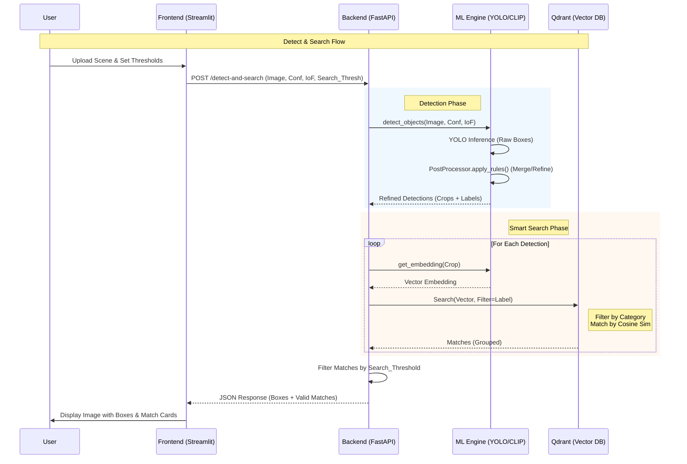

# System Architecture

This document provides a high-level overview of the retrieval service architecture, including its components and core data flows.

## 1. System Components

The system is built as a modular client-server application, designed for object detection and semantic search.

*   **Frontend (Streamlit)**:
    *   Located in `src/frontend.py`.
    *   Provides the user interface for uploading images, searching objects, and managing inventory.
    *   Handles image visualization (drawing bounding boxes) and user interactions.
    *   Communicates with the Backend via REST API calls.

*   **Backend (FastAPI)**:
    *   Located in `src/main.py`.
    *   Exposes REST endpoints (`/store`, `/detect-and-search`, `/objects`, etc.).
    *   Orchestrates the flow between the API, ML Engine, and Database.
    *   Serves static files (uploaded images).

*   **ML Engine (YOLO + CLIP)**:
    *   Located in `src/ml_engine.py`.
    *   **Object Detection**: Uses a custom-trained YOLO model (`weights/Golden.pt`) to detect objects in scenes and generate bounding boxes.
    *   **Feature Extraction**: Uses OpenAI's CLIP model (`clip-ViT-B-32`) to generate vector embeddings from images (or crops) for semantic understanding.

*   **Vector Database (Qdrant)**:
    *   Managed via `src/database.py`.
    *   Stores high-dimensional vector embeddings of objects along with their metadata (name, category, price, etc.).
    *   Performs fast similarity searches (Cosine Distance) to find matching objects.

---

## 2. Core Processes

### 2.1. Upload & Store Flow (2-Stage)
This process ensures high-quality data entry by allowing users to verify detections before storing them.

1.  **Stage 1: Upload & Analyze**:
    *   User uploads images via the Frontend.
    *   System runs **Detection Only** (via `/detect-and-search`) to find potential objects.
    *   Frontend displays detections with cropped previews for verification.
2.  **Stage 2: Select & Store**:
    *   User selects/unselects valid objects from the previews.
    *   User enters or confirms metadata (Name, Category, etc.).
    *   Frontend sends the **selected crops** and metadata to the `/store` endpoint.
3.  **Backend Processing**:
    *   Receives the confirmed object crops.
    *   Generates or uses existing `object_id` (for variants).
    *   Stores embeddings and images in Qdrant and disk.
4.  **Result**: The object is indexed and instantly searchable.

### 2.2. Search Flow
This process finds similar objects using semantic search with intelligent filtering.

1.  **User Input**: User uploads a scene image and adjusts thresholds (optional):
    *   **Detection Confidence**: Sensitivity of object finder.
    *   **Search Threshold**: Similarity checking strictness.
2.  **Backend Processing (`/detect-and-search`)**:
    *   **Detect**: YOLO runs with the user-defined `conf_threshold`.
    *   **Post-Process**: `PostProcessor` applies rules (IoF Merge, Conflict Resolution) using `iof_threshold`.
    *   **Filter**: For each detection, the system extracts its **Label** (e.g., "Architecture").
    *   **Search**: Qdrant queries for similar vectors **restricted to that Category**.
    *   **Refine**: Matches are filtered again by the `search_threshold`.
3.  **Response**: Validated matches are returned grouped by Object ID.
4.  **Visualization**: Frontend draws bounding boxes and lists the specific inventory matches for each detected item.

## 3. System Data Flow

The following diagram illustrates the interactions during the **Search Flow**, highlighting the new post-processing layer and category-based filtering.

